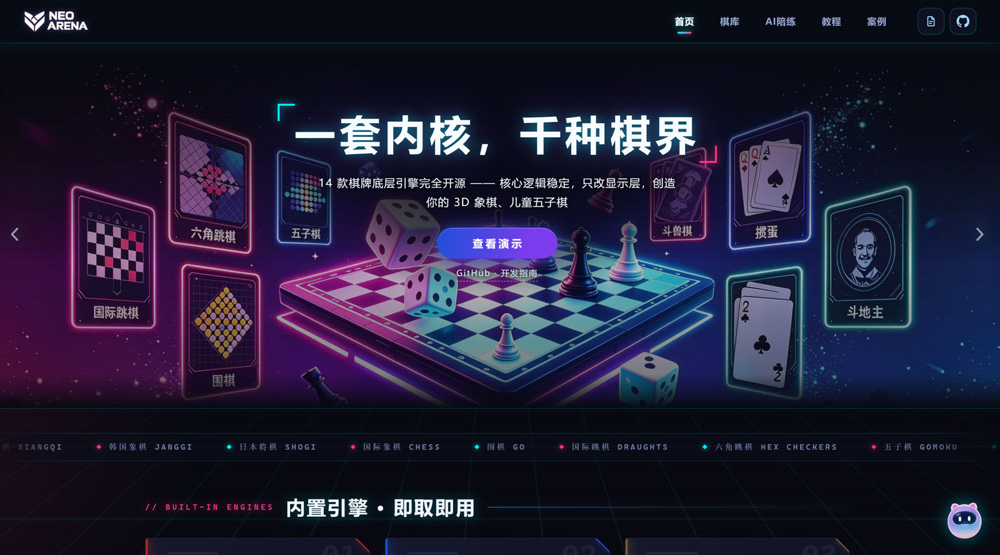
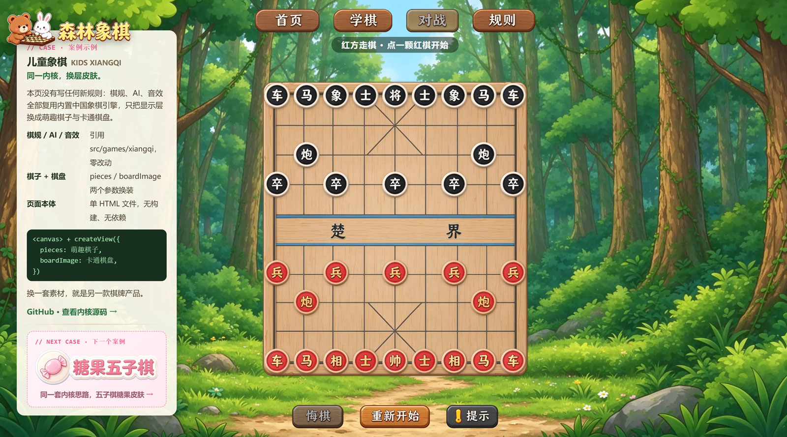
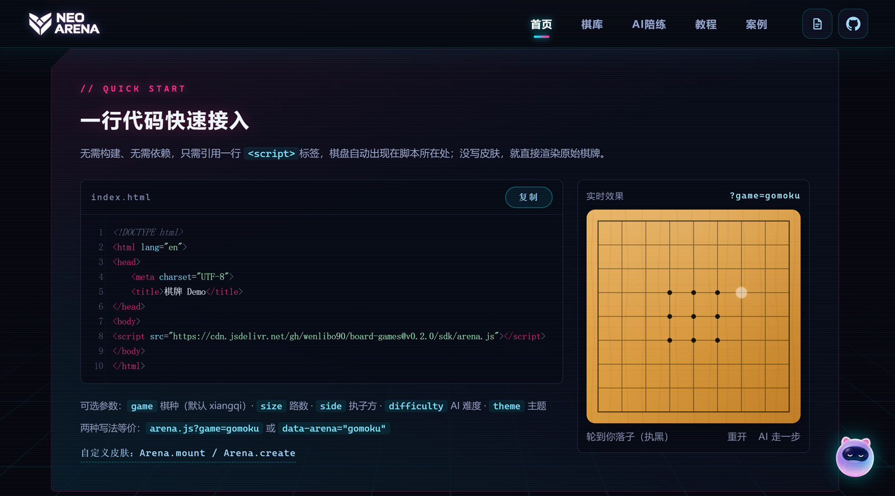
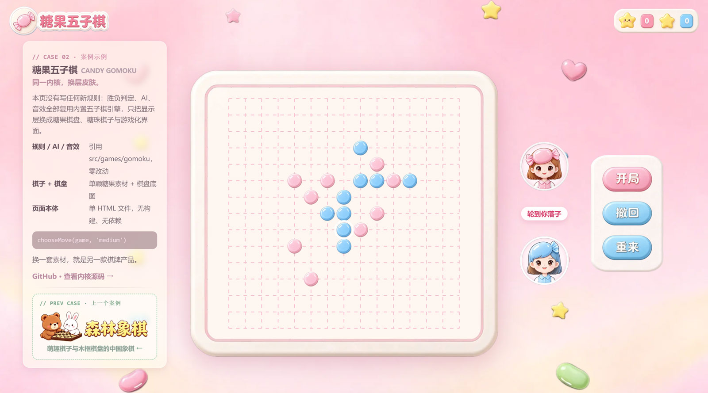

# 弈趣棋坊 · Neon Arena — 开源棋牌引擎平台

**一套内核，千种棋界。**

本项目把 14 款经典棋牌的**底层代码（规则引擎 + 本地 AI + 教学）完全开源**：核心逻辑稳定不变，显示层（皮肤、主题、棋盘、棋子、动效、甚至整页 UI）全部外置可替换。你可以基于同一套内核，改造出 3D 象棋、儿童五子棋、国风围棋……属于你自己的棋牌产品。

- **纯前端、零构建**：原生 ES Modules + Canvas，无第三方依赖、无后端，打开即玩
- **一行接入**：外部页面引一个 JS 就能玩，没写皮肤时直接渲染原始棋牌（见下方 SDK）
- **规则与显示解耦**：引擎只负责规则与 AI，`createGame` / `ai.move` 等契约稳定，换皮不动内核
- **皮肤系统**：按棋种定制整页风格（`html[data-game="<id>"]` 一段 CSS 即可），支持整页自定义 UI
- **本地 AI**：极小极大 / Alpha-Beta / 启发式，离线可玩，支持难度分档
- **新手教学**：每个棋种内置互动课程
- 桌面/移动端自适应，对局在当前页以弹窗打开，首页为霓虹电竞风格

## 项目截图

> 图片放在 `assets/screenshots/`，格式 `jpg`。

| 首页 · 霓虹棋库 | 对局界面 · 中国象棋 |
|---|---|
|  |  |

| 一行代码接入 · SDK | 儿童案例页 · 同一内核换皮肤 |
|---|---|
|  |  |

## 棋种一览（14 款）

| 名称 | id | 简介 |
|---|---|---|
| 中国象棋 | `xiangqi` | 楚河汉界、九宫、飞将、蹩马腿、隔子炮 |
| 韩国象棋 | `janggi` | 隔子包炮且不能吃炮、用字象、士将斜行 |
| 日本将棋 | `shogi` | 升变、持驹打入、二步与打步诘 |
| 国际象棋 | `chess` | 王车易位、吃过路兵、兵升变、将杀判定 |
| 围棋 | `go` | 提子、打劫、禁着点、中国规则数子 |
| 国际跳棋 | `draughts` | 10x10、强制吃子、连吃、飞王 |
| 六角跳棋 | `chinesecheckers` | 六角星棋盘、连续跳跃、抢占对岸 |
| 五子棋 | `gomoku` | 连五获胜；含独立整页界面（13/15/19 路） |
| 黑白棋 | `reversi` | 夹子翻转、自动跳过、占角策略 |
| 斗兽棋 | `jungle` | 等级吃子、鼠象相克、虎狮跳河、兽穴取胜 |
| UNO | `uno` | 4 人；跳过/反转/+2/变色/+4 |
| 升级 / 拖拉机 | `shengji` | 四人两队、亮主、跟花色、分牌计分 |
| 掼蛋 | `guandan` | 双副牌、四人两队、比牌配合 |
| 斗地主 | `doudizhu` | 3 人、叫分抢地主、全套牌型 |

## 快速开始

项目为纯静态站点，**无需安装依赖、无需构建**。用任意静态服务器托管即可：

```bash
python3 -m http.server 8000
```

然后访问 http://localhost:8000

> 根路径 `/` 即首页。也可以用其他静态服务器（nginx、`npx serve` 等）指向仓库根目录。

### 启停脚本

仓库提供 `start.sh` / `stop.sh`（端口固定 `8000`）：

- `bash start.sh`：已启动则直接返回 `0`；未启动时启动成功返回 `0`，失败返回 `2`
- `bash stop.sh`：用 `ss` 提取监听端口的 PID 并结束进程
- 服务由 `server.py` 提供：根路径返回 `index.html`、禁用目录列表、禁用缓存

## 一行代码接入（SDK）

不想研究源码，只想在自己页面里放一局棋？给任意 HTML 加一行即可：

```html
<script src="https://cdn.jsdelivr.net/gh/wenlibo90/board-games@v0.2.0/sdk/arena.js"></script>
```

棋盘会出现在脚本所在位置，默认渲染中国象棋；没有写皮肤时直接渲染原始棋牌。

换棋种与参数（查询串与 `data-*` 两种写法等价）：

```html
<script src="https://cdn.jsdelivr.net/gh/wenlibo90/board-games@v0.2.0/sdk/arena.js?game=gomoku&size=15"></script>
<script src="https://cdn.jsdelivr.net/gh/wenlibo90/board-games@v0.2.0/sdk/arena.js" data-arena="chess" data-difficulty="hard"></script>
```

| 参数 | 说明 |
|---|---|
| `game` / `data-arena` | 棋种 id，默认 `xiangqi` |
| `size` / `data-size` | 棋盘路数（围棋、五子棋等） |
| `side` / `data-side` | 执子方 |
| `difficulty` / `data-difficulty` | AI 难度，默认 `hard` |
| `theme` / `data-theme` | 明/暗主题 |

用核心 API 自定义皮肤（加 `data-manual` 可关闭自动挂载）：

```js
const game = await Arena.create('xiangqi');
game.state;                   // 原始引擎实例（board / hands …）
game.legalMoves();            // 合法着法，直接传给 play()
game.play(move);
game.playAI({ difficulty: 'hard' });
game.undo(); game.save(); game.load(snapshot);
game.ended; game.result; game.turn;
```

`demo.html` 是最小用法页（本地打开即可运行）。自行构建单文件包：

```bash
npm install -g esbuild
node tools/build-sdk.mjs
```

产物：`sdk/arena.js`（浏览器单文件）、`dist/sdk.esm.js`（按需分包）、`dist/sdk.cjs`、`dist/sdk.d.ts`。

## 目录结构

```
.
├── index.html                # 唯一入口（霓虹首页 + 对局弹窗 + 教学视图 + 赞赏弹窗）
├── demo.html                 # SDK 最小用法页（引用 sdk/arena.js）
├── xiangqi-kids.html         # 儿童象棋案例页（同一内核，换皮肤）
├── gomoku-kids.html          # 儿童五子棋案例页
├── sdk/
│   └── arena.js              # 单文件浏览器包（外部页面一行 <script> 即可用）
├── assets/
│   ├── styles.css            # 基础样式、霓虹首页、对局外壳与赞赏弹窗
│   ├── skins.css             # 按棋种定制皮肤的规则（html[data-game="<id>"]）
│   ├── logo.png              # 站点 logo（占位，可替换）
│   ├── home-hero.webp        # 首页背景图（可替换）
│   ├── gomoku-page.css       # 五子棋整页样式
│   ├── gomoku-page.js        # 五子棋整页脚本（自带 AI/音效/礼花/结算弹窗）
│   ├── wxpay.jpg             # 微信赞赏码
│   ├── alipay.jpg            # 支付宝赞赏码
│   ├── kids-xiangqi/         # 儿童象棋素材（WebP）
│   └── screenshots/          # 项目截图（jpg）
├── src/
│   ├── app.js                # 应用入口
│   ├── core/                 # 与棋种无关的共享基础
│   │   ├── stage.js          # Canvas 舞台（DPR、尺寸、指针事件归一化）
│   │   ├── theme.js          # 明/暗主题
│   │   ├── cards.js          # 扑克牌堆 / 洗牌
│   │   ├── cardgfx.js        # 牌面绘制与手牌布局/选择（HandUI）
│   │   └── sfx.js            # 落子音效合成
│   ├── platform/             # 平台外壳
│   │   ├── shell.js          # 首页、路由(#/go)、对局弹窗外壳、侧栏生成
│   │   ├── registry.js       # 棋种注册表
│   │   ├── games-meta.js     # 轻量元数据 + 按需加载器
│   │   └── tutorial.js       # 通用教学控制器
│   ├── sdk/                  # 棋牌核心 SDK
│   │   ├── index.js          # 统一门面（create / list / register / Session）
│   │   ├── catalog.js        # 棋种清单与核心加载器
│   │   ├── mount.js          # 默认皮肤挂载（mount / autoMount）
│   │   ├── browser.js        # <script> 入口（零容器自动挂载）
│   │   └── index.d.ts        # 类型声明
│   └── games/                # 各棋种自包含模块
│       ├── go/               # engine / ai / view / lessons / index
│       ├── xiangqi/          # ...
│       └── ...
├── tools/
│   └── build-sdk.mjs         # 构建 SDK（esbuild）
├── server.py                 # 静态服务器（根路径返回 index.html）
├── start.sh / stop.sh        # 启停脚本（端口 8000）
└── README.md
```

## 架构与棋种契约

平台与棋种解耦：外壳只依赖统一契约，每个棋种是 `src/games/<id>/` 下自包含的一组文件。**这正是「核心逻辑不变、显示层随便改」的基础。**

**模块清单（`games/<id>/index.js` 默认导出）常用字段**

- 元信息：`id`、`name`、`nameEn`、`tagline`、`description`、`accent`、`art`（首页卡片 SVG）
- 渲染：`palettes`（`{light, dark}` 棋盘配色）、`createView(canvas, opts)`
- 对局：`createGame(config)`、`ai.move(game, difficulty)`、`ai.hint(game, color)`
- UI：`setup[]`（设置项）、`supports`（undo/hint/resign/pass/estimate）、`helpers[]`、`stats(game)`、`statusLine(game, ctx)`、`dotColor(game)`
- 教学：`lessons[]`、`tutorial.buildGame(lesson)`
- 牌类扩展：`buttons[]`、`onAction(game, key, view)`、`buttonEnabled(game, key)`
- 皮肤/整页：`skin`、`customPage`、`mountPage(container, { onExit })`

**游戏对象约定**：`turn`、`ended`、`result`、`moves[]`、`play(move) ⇢ {ok}`、`undo()`、`resign(color)`（围棋另有 `pass()`）。

**视图对象约定**：`render(game)`、`resize()`、`setPalette(p)`、`interactive`；可选 `setDecor`、`setHint`、`setOverlay`、`setViewer`（暗棋隐藏信息）、`getSelection`/`clearSelection`（牌类）。

## 二次开发指南

### 场景 A：只想换皮（最快）

不改任何 JS。在 `assets/skins.css` 里加一段 `html[data-game="<id>"] { ... }`，覆盖设计变量与组件样式，即可整页换风格；棋盘本身的配色在棋种 `view.js` 的 `palettes` 中调整。适合做主题包、节日限定皮肤。

### 场景 B：做儿童版 / 3D 版等衍生产品

两种路径：

1. **换视图层（推荐）**：保留 `engine.js` / `ai.js` 不动，重写 `view.js`——用 Three.js / WebGL 渲染 3D 棋盘，或做放大棋子、音效、卡通贴纸的儿童界面。契约不变（`createView(canvas, { onMove, palette })`），外壳无感知。
2. **整页自定义**：模块声明 `customPage: true` 并提供 `mountPage(container, { onExit })`，外壳会隐藏通用棋盘/侧栏，整页交给你的 UI（参考 `src/games/gomoku/`，自带 AI、音效、礼花、结算弹窗）。

### 场景 C：新增一个棋种

1. 新建 `src/games/<id>/`，实现以下文件：
   - `engine.js`：规则引擎（状态、走法、胜负）
   - `ai.js`：AI（`move(game, difficulty)`）
   - `view.js`：`createView(canvas, { onMove, palette })`
   - `lessons.js`：教学课程与 `tutorial.buildGame`
   - `index.js`：模块清单（默认导出上述字段）
2. 在 `src/platform/registry.js` 中 `import` 并加入 `GAMES` 数组（决定首页顺序）。

外壳会自动提供：首页卡片、路由、对局弹窗外壳（设置/信息/操作/辅助面板）、教学标签与流程。

### 牌类扩展

- 牌堆与洗牌：`src/core/cards.js`
- 牌面绘制与手牌选择：`src/core/cardgfx.js`（`HandUI`）
- 自定义操作按钮：模块声明 `buttons: [{ key, label, tone? }]` 并实现 `onAction(game, key, view)`、可选 `buttonEnabled(game, key)`；按钮显示在右侧「操作」面板。

## 已知简化

为控制规模，部分牌类采用简化规则（接口/流程完整，规则子集）：

- **升级 / 拖拉机**：单副牌、单张墩、单局 80 分计分；暂不含对子/拖拉机与跨局升级
- **掼蛋**：双副牌组队比牌；暂不含「逢人配」（级牌万能）、进贡与跨局升级
- **斗地主**：叫分简化为 1/2/3 出价最高者当地主（全不叫则重发）
- **UNO**：自动宣告 UNO（无罚则），+4 简化处理

## 技术栈

- 原生 JavaScript（ES Modules）、HTML5 Canvas 2D
- 无第三方依赖、无构建步骤、无后端
- AI 为本地算法（极小极大/Alpha-Beta/启发式），离线可玩
- SDK 打包仅用到 `esbuild`（全局安装，仅构建时需要）

## 部署

任何静态托管均可（GitHub Pages、Vercel、Netlify、Nginx 等）。由于无需构建，直接把仓库根目录作为站点根发布即可。

在线地址：https://wenlibo90.github.io/board-games/

## 赞赏支持

很高兴你看到了这里。

这个项目从规则内核到棋盘绘制，都是业余时间一点点写出来的。如果它帮你省下了一些时间，或者你单纯的觉得它还不错，欢迎请作者喝杯咖啡——这份心意会直接变成后续的更新与打磨。

| 微信赞赏 | 支付宝赞赏 |
|---|---|
|  |  |

打开微信扫一扫 · 打开支付宝扫一扫

> 赞赏完全自愿，不影响任何现有功能的使用。

## 许可

本项目暂未声明开源许可证；如需开源，请补充 `LICENSE` 文件。
